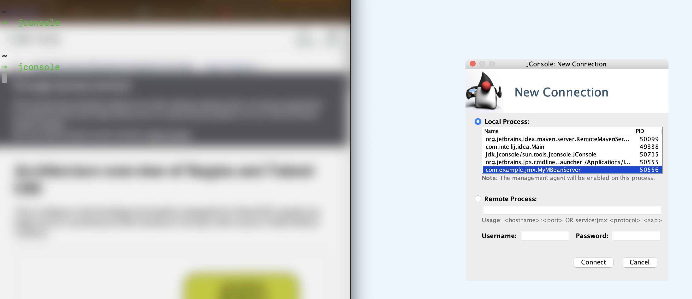
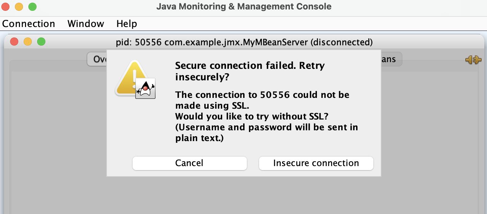
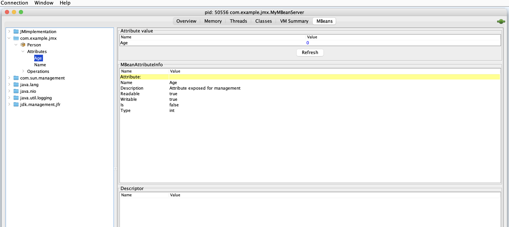
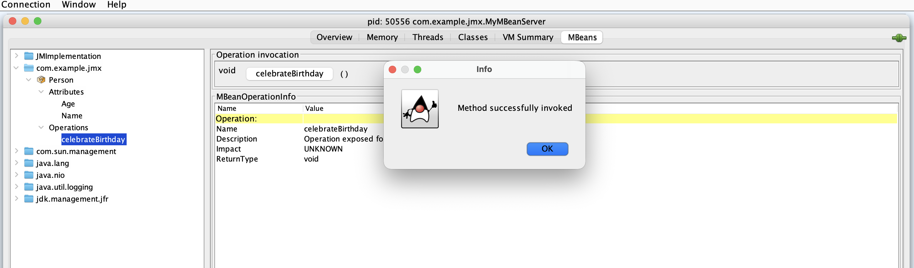
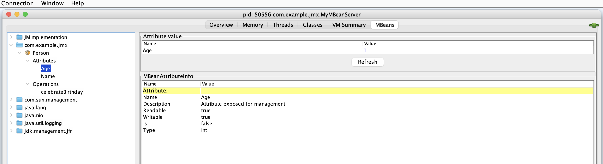
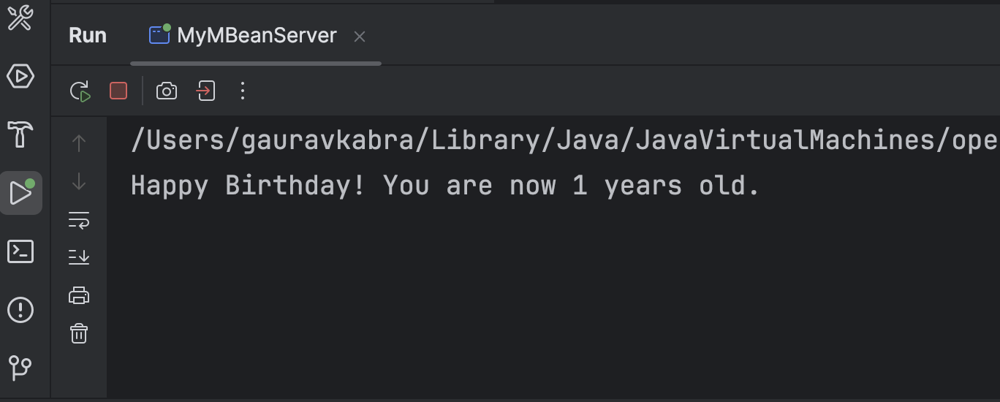

# JMX (Java Management Extensions) Basics
by Gaurav Kabra

---

For an MBean, Java expects:
1. A class X
2. X must implement the interface XMBean

Else, you will get a runtime exception when trying to register the MBean with the MBean server:
```
Exception in thread "main" javax.management.NotCompliantMBeanException: MBean class com.example.jmx.Person does not implement DynamicMBean, and neither follows the Standard MBean conventions (javax.management.NotCompliantMBeanException: Class com.example.jmx.Person is not a JMX compliant Standard MBean) nor the MXBean conventions (javax.management.NotCompliantMBeanException: com.example.jmx.Person: Class com.example.jmx.Person is not a JMX compliant MXBean)
```

The interface can legally be empty. 
But generally it is not, because interface defines the methods that will be exposed for management operations.








